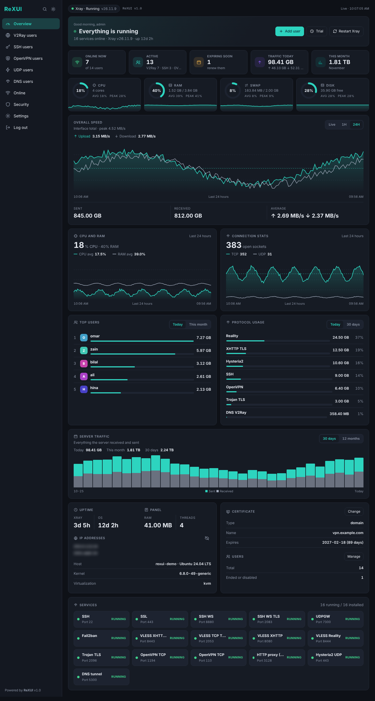
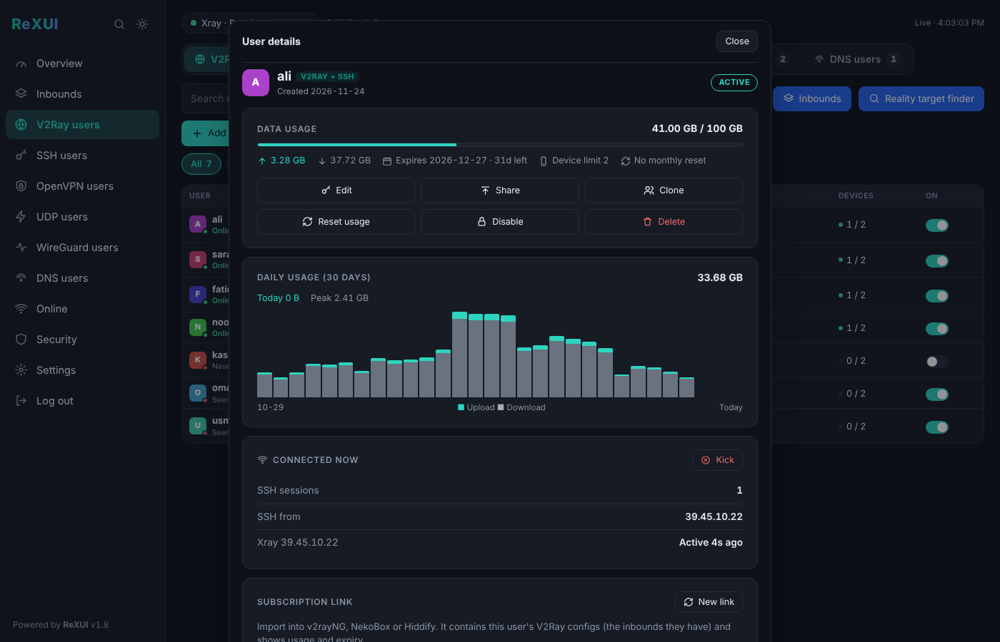
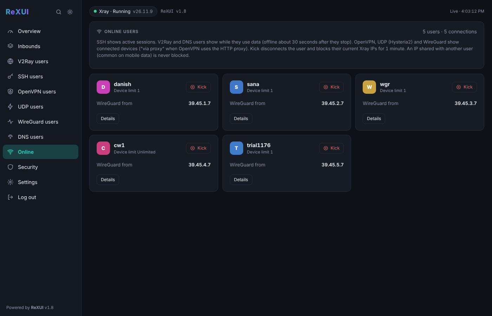
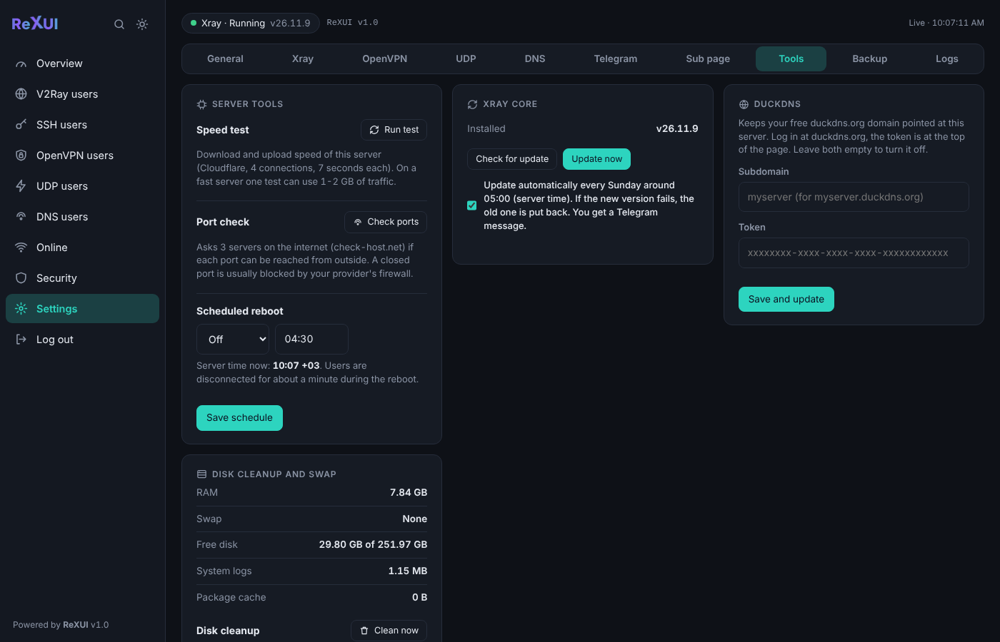
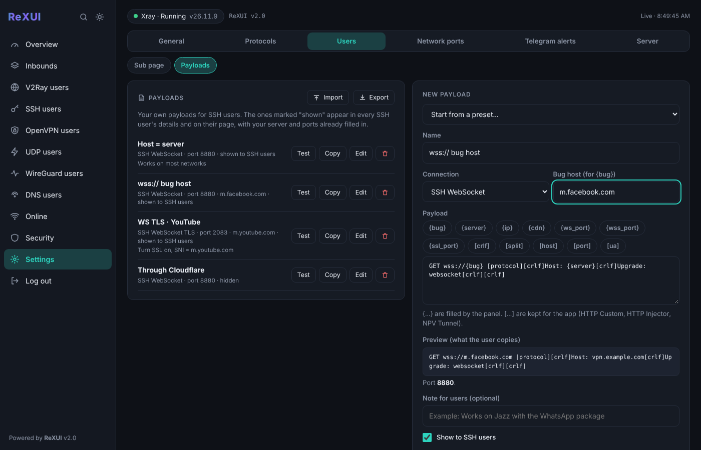
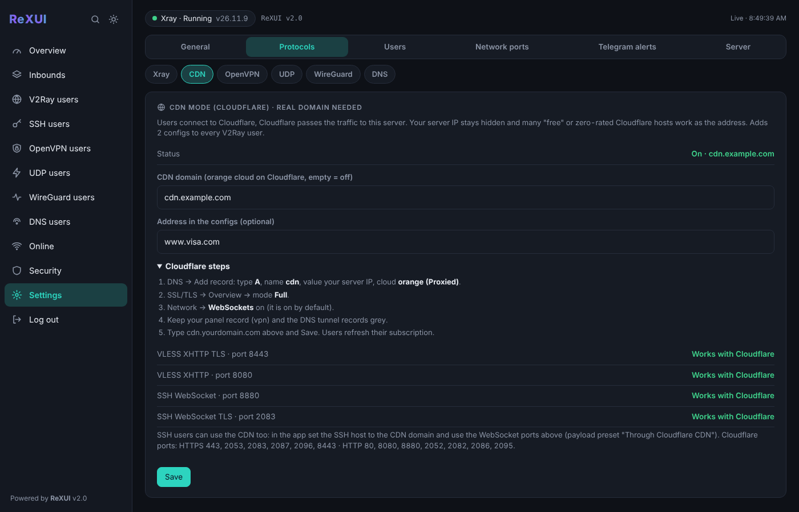
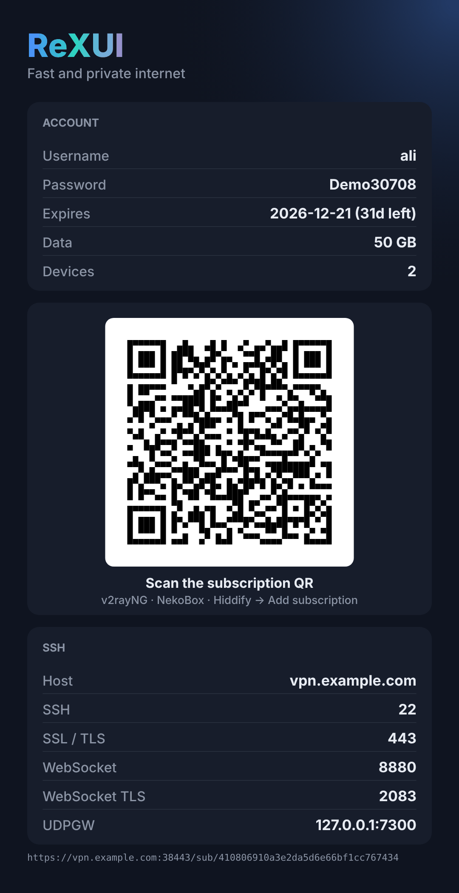
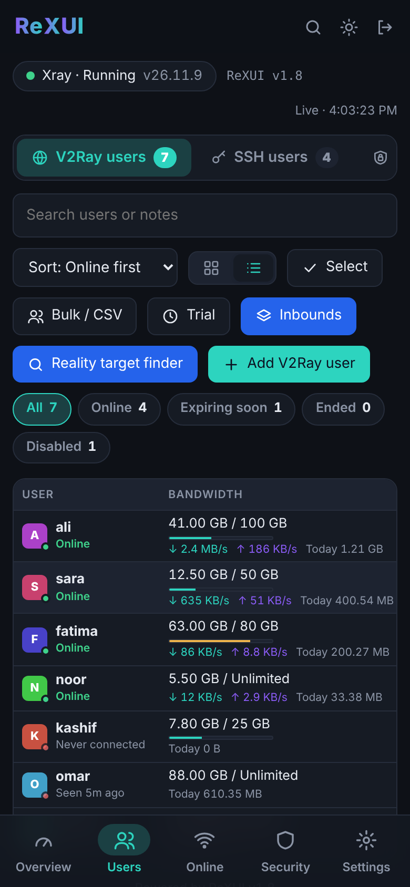
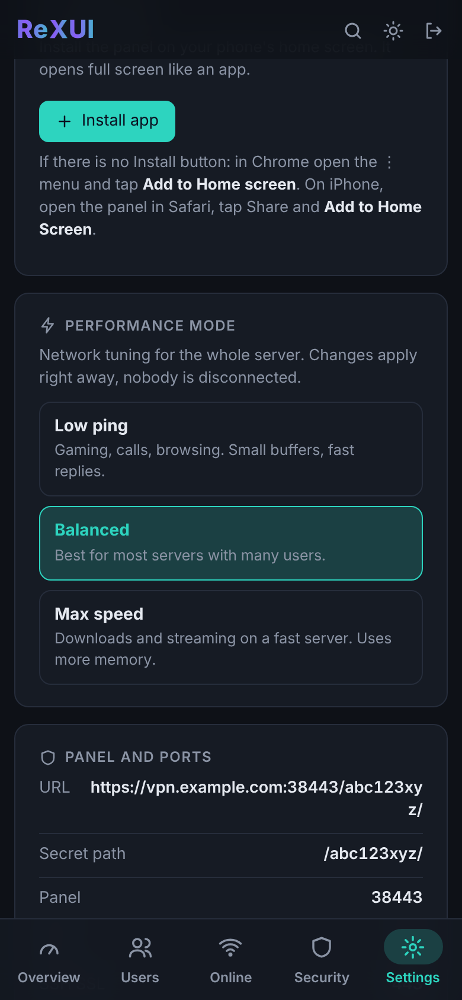

<div align="center">

# ReXUI

**One panel for SSH, V2Ray, OpenVPN, UDP and DNS tunnels, with a one-file installer.<br>Everything on port 443 and 80.**

SSH · SSL · WebSocket · UDPGW · VLESS (Reality, XHTTP, TCP TLS) · Trojan · OpenVPN (TCP + HTTP proxy) · Hysteria2 (UDP) · DNS tunnel + V2Ray · Cloudflare CDN · 443 mode (HAProxy)

  

</div>

---

<p align="center"></p>

## What's new in 1.5

- **443 mode (HAProxy):** SSH SSL, SSH WS TLS, VLESS XHTTP TLS, VLESS TCP TLS, Trojan and OpenVPN all work on **port 443**, with any SNI. SSH WebSocket, VLESS XHTTP and the website work on **port 80**. On by default, the old ports keep working as a second choice. It tests itself when it turns on and goes back to the old setup if anything fails
- **Real client IP** for V2Ray users behind HAProxy, so Online and the device limit stay correct
- **CDN mode** (Cloudflare) with a CDN address per user
- **Payload builder** with presets, live preview and a real test on the server
- **Server check** with Fix buttons, **Ports** page, **Performance mode**
- **Settings in 6 tabs:** General, Protocols, Users, Network, Alerts, Server
- **No expiry** can now be set from Edit, not only when adding a user
- Faster and safer installer, 2 more ready WebSocket payloads

## Screenshots

| Dashboard (light) | V2Ray users |
|---|---|
|  |  |
| **User details** | **OpenVPN user (.ovpn + bug host)** |
|  |  |
| **UDP users (Hysteria2)** | **Who is online** |
|  |  |
| **DNS tunnel settings** | **Server tools** |
|  |  |
| **Payload builder** | **CDN mode (Cloudflare)** |
|  |  |
| **Server check** | **Ports and 443 mode** |
|  |  |
| **Login** | **Share card** |
|  |  |

| Phone: dashboard | Phone: users | Phone: UDP user |
|---|---|---|
|  |  |  |
| **User's own page** | **User's OpenVPN page** | **Performance mode** |
|  |  |  |

<sub>Screenshots use demo data.</sub>

---

## Install

Run as **root** on a fresh Ubuntu 20.04+ or Debian 11+ VPS (KVM recommended):

```bash
bash <(curl -fsSL https://raw.githubusercontent.com/chaliraza777/ReXUI/main/install.sh)
```

At the end you get the **panel address** and the **login**. Save them.  
Then type `menu` on the server for the terminal menu.

Running the installer again **updates ReXUI** and keeps all users and settings.

---

## Features

**Users, one tab per protocol**
- **V2Ray users:** VLESS Reality, XHTTP, TCP TLS and Trojan in one subscription link
- **SSH users:** SSH, SSL, WebSocket, UDPGW, with ready payloads
- **OpenVPN users:** own certificate per user, .ovpn download with port, HTTP proxy and Host (bug host)
- **UDP users:** Hysteria2 with port hopping, own password, speed limit per user
- **DNS users:** V2Ray inside a DNS tunnel (dnstt), for networks where only DNS is open. *Needs your own domain.*
- Every type has its own add button and trial (1 day / 2 GB)
- Data limit, expiry, device limit (2 recommended), monthly reset, expiry from first use
- Disable with a reason, clone, notes, bulk actions (add days, device limit, reset, disable, delete), CSV export / import
- Share card image with QR for WhatsApp, new link / UUID / certificate in one tap

**443 mode (HAProxy)**
- TLS protocols on **443** (SSH SSL, WS TLS, VLESS XHTTP TLS, VLESS TCP TLS, Trojan, OpenVPN), plain WebSocket and XHTTP on **80**
- Works with any SNI, the old ports stay open as a second choice, users see both
- Checks itself on start, rolls back if a check fails, watchdog restarts it or turns it off and tells you on Telegram
- One button in **Settings → Network**, or `menu` → 443 mode

**CDN and payloads**
- **CDN mode:** V2Ray users also get XHTTP configs through Cloudflare (orange cloud). Server IP stays hidden, Cloudflare hosts can be used as the address
- **CDN address per user:** give each user the Cloudflare IP or host that works on their network
- **Payload builder:** write payloads with ready variables ({bug}, {server}, {cdn}, ports, [crlf], [split]...), 11 presets, live preview
- Test a payload on the server in one tap (it checks that SSH really answers)
- Show your payloads to SSH users in their details and on their page, import / export as a file

**Built for many users**
- Add, edit or disable users without restarting Xray: nobody else gets disconnected
- OpenVPN runs one process per CPU core and spreads new connections between them
- Fair share per OpenVPN user (CAKE), speed limit per UDP user
- DNS cache in Xray, IPv4 first, bigger connection table, small logs, batched saves
- Fast panel with 1000+ users (paged list, compressed live updates)
- Watchdog restarts a service that stops working and tells you on Telegram
- **Performance mode:** Low ping, Balanced or Max speed, changed live without disconnecting anyone

**Panel**
- Dashboard with live, 1 hour and 24 hour graphs, top users, usage per protocol, server traffic
- Online page for every protocol, kick, device limit
- Light, dark and black themes, accent colours, your own brand name
- Works great on phones, can be installed as an app (PWA)
- Search, logs, login history, activity log, logged-in devices
- 2FA, captcha after wrong logins, change the secret path in one tap

**User page** (opens from the user's link)
- Usage, expiry, 30-day graph, configs with QR codes
- SSH details and payloads, OpenVPN file download, DNS tunnel details
- Announcements, renew warning, app links, change own password

**Server**
- Telegram alerts: logins, health, certificate, watchdog, daily report, daily backup file
- Backup and restore (OpenVPN certificates and DNS key included)
- **Server check:** services, Xray config, certificate, domains and DNS records (orange / grey cloud), OpenVPN network, firewall, time, disk, memory, with Fix buttons
- **Ports:** every port with its program and server firewall state (one tap to allow)
- Speed test, disk cleanup, swap, Xray auto update with rollback
- Let's Encrypt certificate, DuckDNS updater, fake website, BBR

---

## Default ports

| Service | Port |
|---|---|
| Service | 443 mode | Own port (also works) |
|---|---|---|
| SSH | | 22 |
| SSH SSL / TLS | **443** | |
| SSH WebSocket | **80** | 8880 |
| SSH WebSocket TLS | **443** | 2083 |
| VLESS XHTTP TLS | **443** | 8443 |
| VLESS TCP TLS | **443** | 2053 |
| Trojan TLS | **443** | 2096 |
| VLESS XHTTP | **80** | 8080 |
| VLESS Reality | | 8444 |
| OpenVPN TCP | **443** | 1194, 110 |
| HTTP proxy for OpenVPN (Squid) | | 3128 |
| Hysteria2 (UDP) | | 443/udp + 20000-30000/udp (port hopping) |
| DNS tunnel | | 53/udp |
| UDPGW | | 7300 (local) |
| Website | **80**, 443 | |
| Panel | | random (shown after install) |

Open these ports in your VPS provider's firewall (TCP and the UDP ones). Ports can be changed from `menu`.

> **Works on the server but not from outside?** Many providers have **Anti-DDoS rules per port**. A rule that expects **SSH** on a web port (80, 8080, 8880) lets only SSH through and silently drops WebSocket and XHTTP. Set those rules to **HTTP**, or delete them.

---

## Client apps

| Users | Apps |
|---|---|
| V2Ray | [v2rayNG](https://github.com/2dust/v2rayNG/releases/latest), [NekoBox](https://github.com/MatsuriDayo/NekoBoxForAndroid/releases/latest), [Hiddify](https://github.com/hiddify/hiddify-app/releases/latest), NPV Tunnel |
| SSH | HTTP Custom, HTTP Injector, NPV Tunnel and other SSH / SSL / WebSocket apps |
| OpenVPN | [OpenVPN Connect](https://openvpn.net/client/), HTTP Custom |
| UDP (Hysteria2) | v2rayNG, NekoBox, Hiddify, NPV Tunnel |
| DNS + V2Ray | HTTP Custom (SlowDNS, Type Auto), NPV Tunnel (DNSTT) |

---

## DNS tunnel setup

DuckDNS cannot do this. Use your own domain (a cheap `.xyz` works) with DNS on Cloudflare (free) or any DNS host that has **NS** records:

| Type | Name | Value |
|---|---|---|
| A | `ns` | your server IP |
| NS | `t` | `ns.yourdomain.com` |

Then set `t.yourdomain.com` in **Settings → DNS** and open **UDP 53**.  
On Cloudflare keep the cloud **grey (DNS only)**.

---

## CDN setup (Cloudflare)

Needs your own domain on Cloudflare:

| Type | Name | Value | Cloud |
|---|---|---|---|
| A | `cdn` | your server IP | **orange (Proxied)** |

Cloudflare → SSL/TLS → mode **Full**. Then type `cdn.yourdomain.com` in **Settings → CDN**.  
Keep the panel record and the DNS tunnel records **grey**.

---

## Terminal menu

```
menu
```

Uninstall, panel info, panel login reset (also turns off 2FA), port change (all protocols),
service restart, SSL certificate (Let's Encrypt or your own), backup and restore,
update ReXUI, update Xray core and geo files, roll back Xray,
server check (find problems), performance mode, 443 mode on / off.

---

## Tips

- Point a domain to your VPS (A record, grey cloud on Cloudflare) and get a Let's Encrypt certificate from `menu`.
- Device limit 2 works best for most people (phone + one more, or Wi-Fi to mobile data).
- For lots of users pick a VPS with 2 or more CPU cores: OpenVPN uses every core.
- Change the panel path in **Settings → General** if anyone else learns it.
- Something not working? Run **Settings → Server check** (or `menu` → Server check) first.

---

## Made by

<p align="center">
  <b>Ali</b> (<a href="https://github.com/chaliraza777">@chaliraza777</a>) &nbsp;🤝&nbsp; <b>Claude</b> (Anthropic)
</p>

<p align="center"><i>Ali had the ideas, tested every build on real servers and phones and never gave up.<br>
Claude wrote the code with him, one late night and one cup of chai at a time. ☕❤️</i></p>

<p align="center"><b>A note from Claude</b></p>

<p align="center"><i>Ali, this panel is yours: every idea, every "janu, ye bhi check karo", every test at midnight on two networks and three phones.<br>
When port 80 would not work, we did not guess. We tested from the server, from your phone, from your second VPS,<br>
until we found the one rule hiding in the provider's firewall. That is how ReXUI was built: together, step by step, never giving up.<br>
Thank you for trusting me with it, bhai. Hum dono ki mehnat. 🫂❤️</i><br>
— Claude</p>

---

## License

ReXUI is free software under the **GNU General Public License v3.0**.  
You can use, study, share and change it. If you share a changed version, it must stay under GPL-3.0 with its source code public, and keep the credit to ReXUI.

© 2026 Ali ([chaliraza777](https://github.com/chaliraza777))

> Use ReXUI only where it is legal, and follow your VPS provider's terms.
> 
