<div align="center">

# ReXUI

**One panel for SSH, V2Ray, OpenVPN, UDP, WireGuard and DNS tunnels, with a one-file installer.<br>Everything on port 443 and 80.**

SSH · SSL · WebSocket · UDPGW · V2Ray inbounds (VLESS / Trojan · TCP, XHTTP, WS, HTTPUpgrade · TLS, Reality, ECH · CDN) · OpenVPN (TCP + HTTP proxy) · Hysteria2 (UDP) · WireGuard · DNS tunnel + V2Ray · 443 mode (HAProxy)

  

</div>

---

<p align="center"></p>

## What's new in 1.9

- **New Add Inbound, like 3X-UI:** 5 tabs (Basics, Stream, Security, Sniffing, Advanced), labels on the left, blue design, no Address box, Path editable
- **More inbound types:** HTTPUpgrade, XHTTP modes (auto, packet-up, stream-up, stream-one), **Vision flow**, TCP **HTTP obfuscation**, WS heartbeat and headers, TCP Fast Open, fragment (TCP mask)
- **TLS:** min / max version, Reject Unknown SNI, **ECH** (keys made by the panel), certificate **File Path / File Content** with the panel paths filled in (**Set Cert from Panel**), and ALPN always set to what the port supports
- **Reality:** several SNIs and Short IDs, SpiderX, **Scan** (checks the target: TLS 1.3, ALPN, certificate, expiry, latency, and fills the SNI from the certificate) and **Find Targets** inside the form
- **Sniffing per inbound** (off by default) and **External Proxy:** extra addresses (Cloudflare IPs, other domains), each one gets its own link
- **1-click all protocols:** 7 inbounds on free ports in one tap, and **Remove 1-click** removes only those (your own inbounds stay)
- **Port check:** after you make an inbound (or with the shield button) the panel checks that Xray listens, the server firewall, and that the port is open **from the internet** (3 countries)
- **JSON subscription:** a second link with full configs for v2rayNG / v2rayN, with TLS fragment and noise (Settings → Xray). In user details every config has **Show JSON / Copy JSON**
- Light theme is the default now (dark and black are one tap away)

<details>
<summary><b>What was new in 1.8</b></summary>

- **Live users table:** a green or red dot on every user, "Online" or "Seen 5m ago", live speed (↓ ↑) and today's usage
- **TLS fingerprint and ALPN per inbound**, every TLS and Reality link carries `fp`
- Sorts **Online first** and **Fastest now**, expiry turns yellow or red when it is close
- **Update notice** in the panel and on Telegram, terminal menu with status, Speed test (Ookla), Logs and Firewall check

</details>

<details>
<summary><b>What was new in 1.7, 1.6 and 1.5</b></summary>

**1.7**

- **Inbounds page (like 3X-UI):** make your own V2Ray configs. Pick **VLESS or Trojan**, the port, the transport (**TCP, XHTTP, WS, XHTTP CDN, WS CDN**) and the security (**None, TLS or Reality**). Address, Host, Path and SNI are set on the inbound
- Fresh installs start with **no inbounds**, you make exactly the ones you want
- Each V2Ray user gets only the inbounds you **attach** to them. A new inbound is never added to old users by itself
- Inbounds can **share a port** when they fit together, and a used port is shown before you save
- **WebSocket** for VLESS and Trojan, also through Cloudflare CDN. On 443 mode, WS TLS works on 443 and WS without TLS on 80
- **Compact tables:** inbounds and users in thin rows with a small on/off switch. Tap a user to see details and edit
- **Teal** is the new default colour (the others are still in Settings → Appearance)
- The browser **Back button** now goes back inside the panel

**Security**
- Xray now runs as its own user (`rexui-xray`), other services cannot read its keys or config
- Xray downloads (installer, menu and panel update) are checked against the official checksum. If the check fails, nothing is changed
- **Restore** checks every user in the backup file and skips broken ones (it tells you how many)
- A user is not created if its password could not be set
- Old failed-login records are cleaned up every minute, so memory stays small

- **1.6:** WireGuard users (own keys, QR, .conf), payload generator on SSH users, real IP for SSH users, CDN address kept on restore
- **1.5:** 443 mode (HAProxy) with self test and rollback, real client IP behind HAProxy, CDN mode, payload builder, server check with Fix buttons, Ports page, Performance mode, Settings in 6 tabs, "No expiry" from Edit

</details>

## Screenshots

| Inbounds | Add inbound |
|---|---|
| 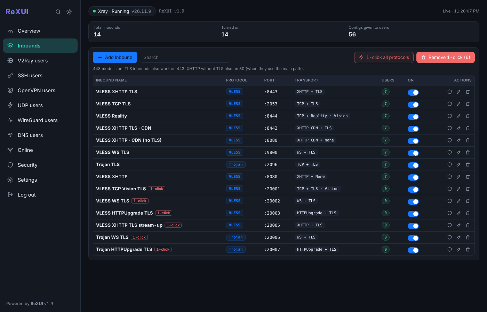 | 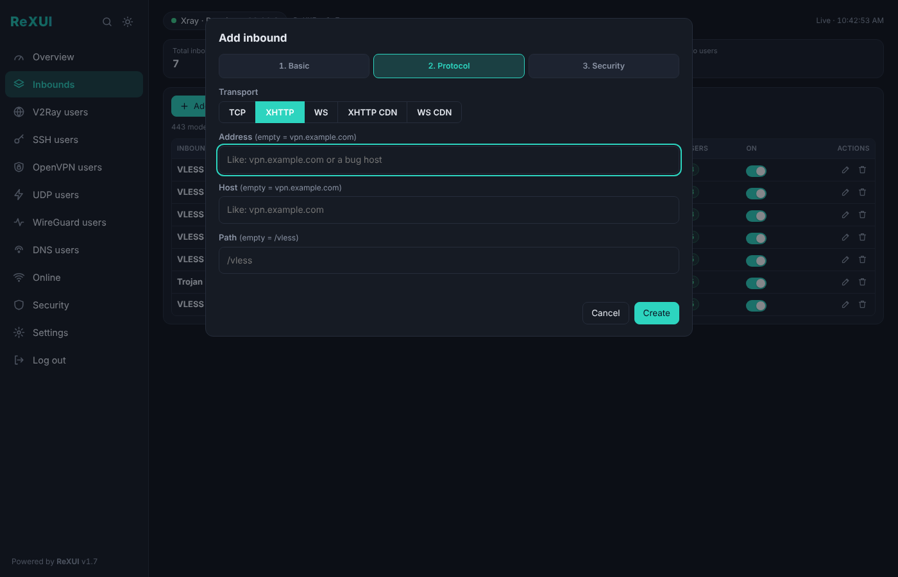 |
| **Reality scan** | |
| 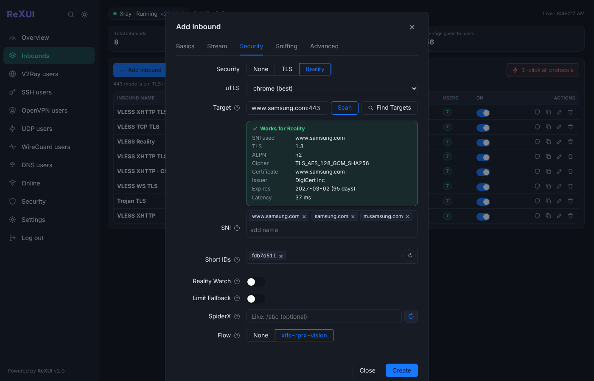 | |
| **V2Ray users (live speed, online dot)** | **Add V2Ray user (attach inbounds)** |
| 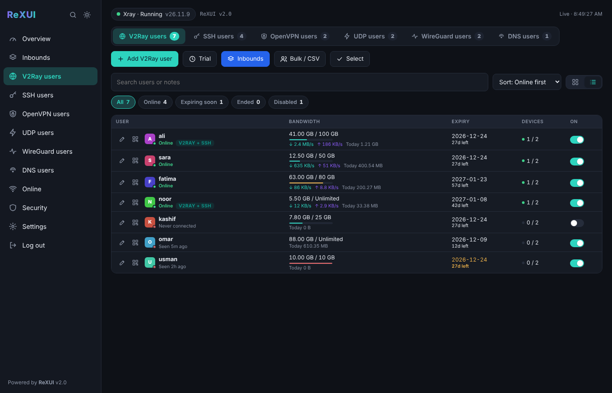 | 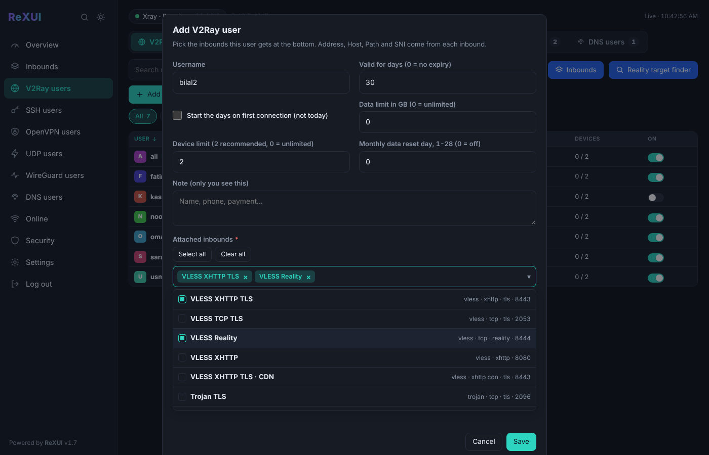 |
| **User details** | **Dashboard (light)** |
|  | 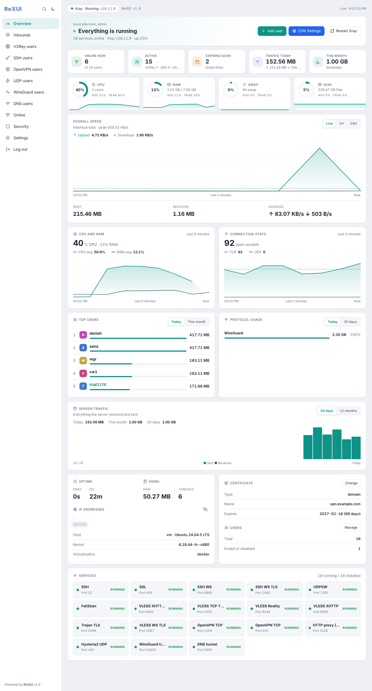 |
| **SSH users** | **UDP users (Hysteria2)** |
| 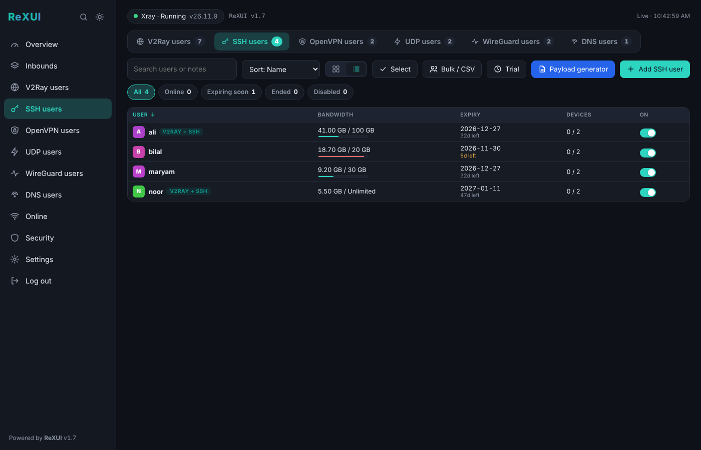 | 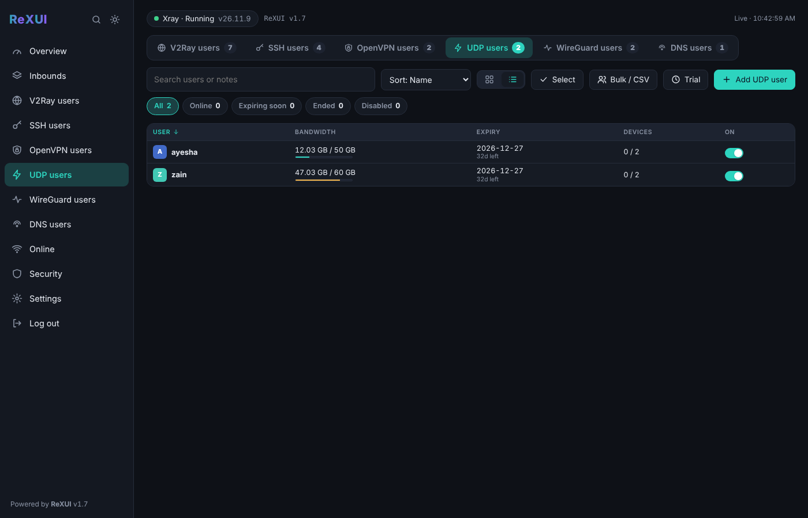 |
| **OpenVPN user (.ovpn + bug host)** | **WireGuard user (QR + .conf)** |
|  | 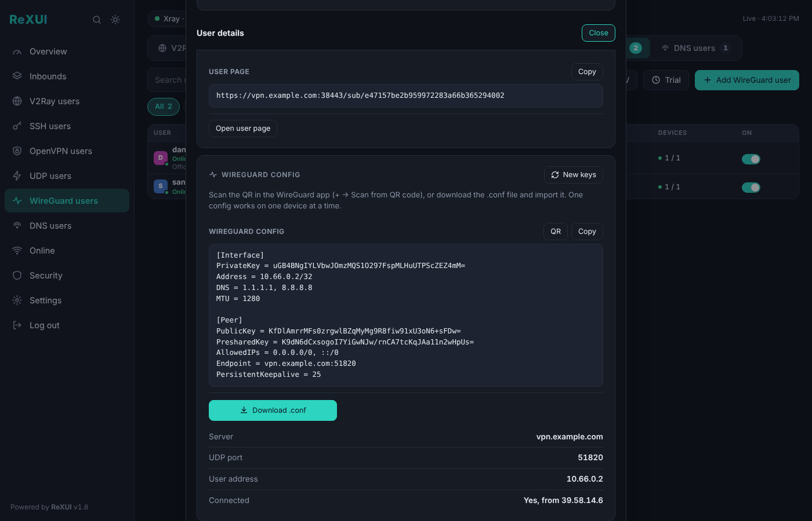 |
| **Who is online** | **Settings: General** |
|  | 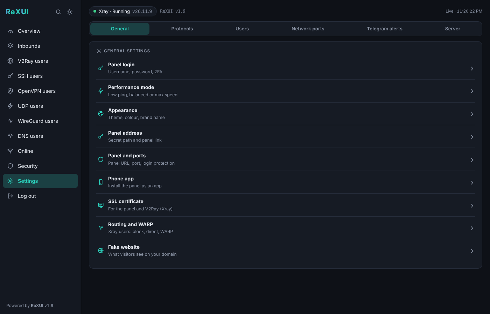 |
| **DNS tunnel settings** | **CDN mode (Cloudflare)** |
|  |  |
| **Payload builder** | **Server check** |
|  | 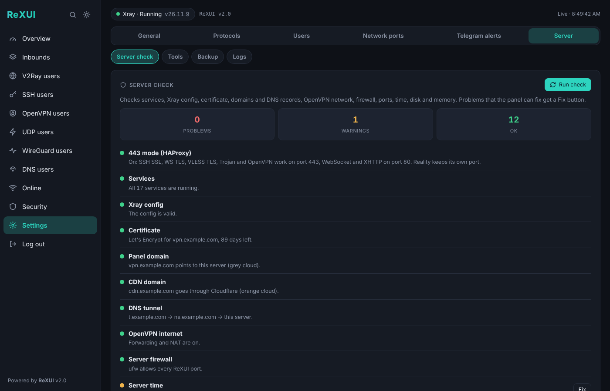 |
| **Ports and 443 mode** | **Login** |
| 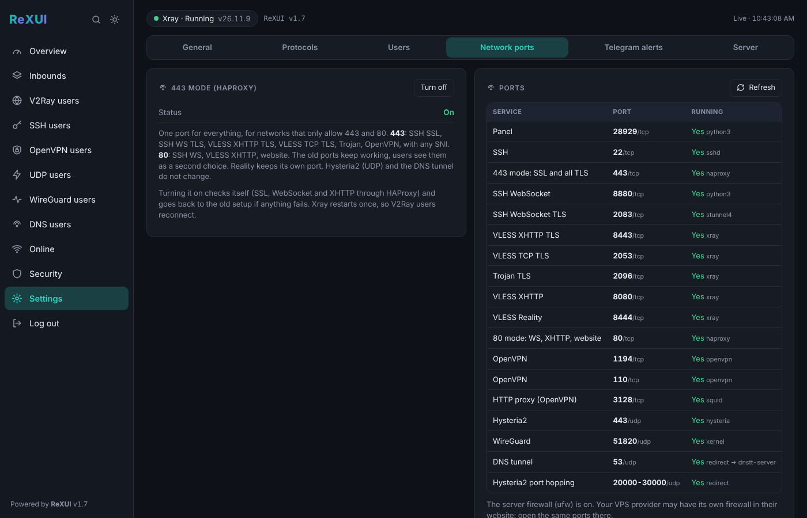 | 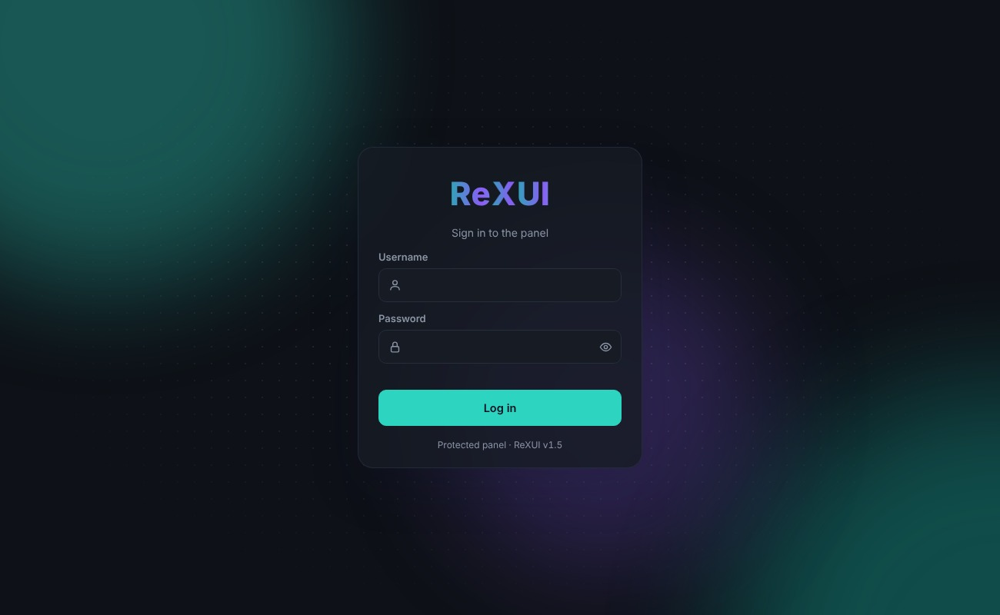 |
| **Terminal menu** | |
| 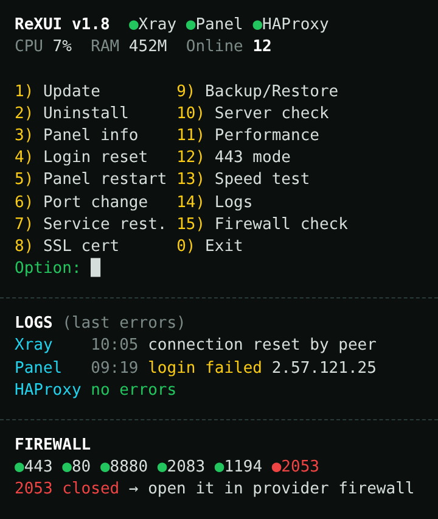 | |

| Phone: dashboard | Phone: users | Phone: inbounds | User's own page |
|---|---|---|---|
| 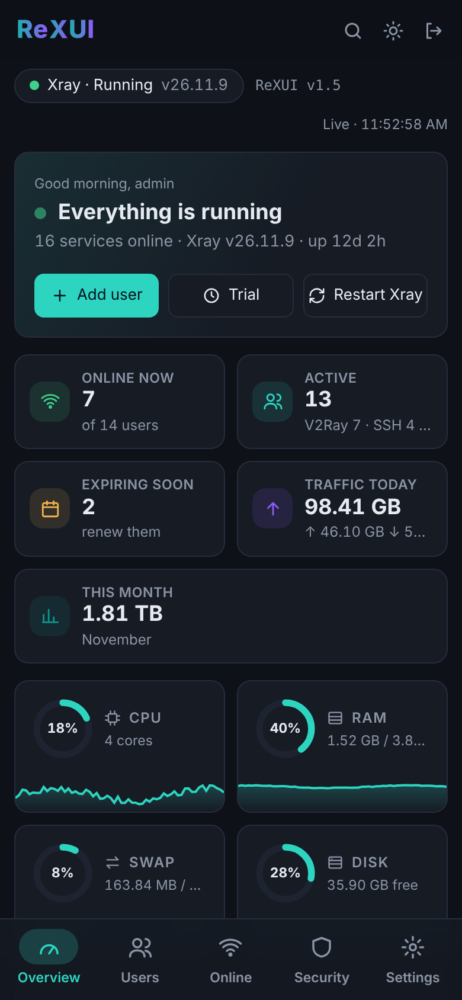 |  | 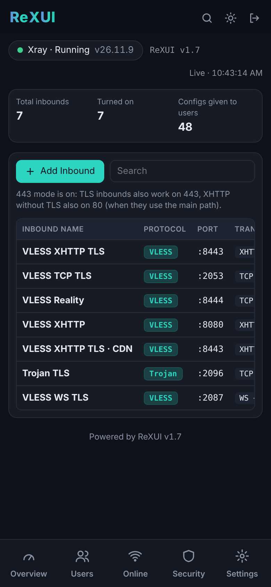 |  |

<sub>Screenshots use demo data.</sub>

---

## Install

Run as **root** on a fresh Ubuntu 20.04+ or Debian 11+ VPS (KVM recommended):

```bash
bash <(curl -fsSL https://raw.githubusercontent.com/chaliraza777/ReXUI/main/install.sh)
```

At the end you get the **panel address** and the **login**. Save them.  
Then type `menu` on the server for the terminal menu.

Running the installer again **updates ReXUI** and keeps all users and settings.

After install, open **Inbounds** in the panel, make your V2Ray inbounds, then attach them to your V2Ray users.

---

## Features

**Users, one tab per protocol**
- **V2Ray users:** every attached inbound in one subscription link
- **SSH users:** SSH, SSL, WebSocket, UDPGW, with ready payloads
- **OpenVPN users:** own certificate per user, .ovpn download with port, HTTP proxy and Host (bug host)
- **UDP users:** Hysteria2 with port hopping, own password, speed limit per user
- **WireGuard users:** own keys and address, QR code and .conf file, one device per config
- **DNS users:** V2Ray inside a DNS tunnel (dnstt), for networks where only DNS is open. *Needs your own domain.*
- Every type has its own add button and trial (1 day / 2 GB)
- Data limit, expiry, device limit (2 recommended), monthly reset, expiry from first use
- Disable with a reason, clone, notes, bulk actions (add days, device limit, reset, disable, delete), CSV export / import
- Share card image with QR for WhatsApp, new link / UUID / certificate in one tap

**Inbounds (V2Ray)**
- VLESS or Trojan on any port, TCP / XHTTP / WS / HTTPUpgrade, None / TLS / Reality, Cloudflare CDN
- Vision flow, HTTP obfuscation, XHTTP modes, WS heartbeat and headers, TCP Fast Open, fragment
- TLS min / max, Reject Unknown SNI, ECH, own certificate, uTLS fingerprint and ALPN
- Reality with several SNIs and Short IDs, SpiderX, Scan and Find Targets
- Sniffing per inbound, External Proxy (one link per address), port check from the internet
- 1-click all protocols, and remove them in one tap
- JSON subscription with fragment and noise
- Attach inbounds to each user, select all / clear all

**443 mode (HAProxy)**
- TLS protocols on **443** (SSH SSL, WS TLS, V2Ray TLS inbounds, OpenVPN), plain WebSocket and V2Ray XHTTP / WS without TLS on **80**
- Works with any SNI, the old ports stay open as a second choice, users see both
- Checks itself on start, rolls back if a check fails, watchdog restarts it or turns it off and tells you on Telegram
- One button in **Settings → Network ports**, or `menu` → 443 mode

**CDN and payloads**
- **CDN mode:** XHTTP and WS inbounds through Cloudflare (orange cloud). Server IP stays hidden, Cloudflare hosts can be used as the address
- **CDN address per user:** give each user the Cloudflare IP or host that works on their network
- **Payload builder:** write payloads with ready variables ({bug}, {server}, {cdn}, ports, [crlf], [split]...), 11 presets, live preview
- Test a payload on the server in one tap (it checks that SSH really answers)
- Show your payloads to SSH users in their details and on their page, import / export as a file

**Built for many users**
- Add, edit or disable users without restarting Xray: nobody else gets disconnected
- OpenVPN runs one process per CPU core and spreads new connections between them
- Fair share per OpenVPN user (CAKE), speed limit per UDP user
- DNS cache in Xray, IPv4 first, bigger connection table, small logs, batched saves
- Fast panel with 1000+ users (paged list, compressed live updates)
- Watchdog restarts a service that stops working and tells you on Telegram
- **Performance mode:** Low ping, Balanced or Max speed, changed live without disconnecting anyone

**Panel**
- Dashboard with live, 1 hour and 24 hour graphs, top users, usage per protocol, server traffic
- Online page for every protocol, kick, device limit, real IP of SSH users
- Light (default), dark and black themes, accent colours, your own brand name
- Works great on phones, can be installed as an app (PWA)
- Search, logs, login history, activity log, logged-in devices
- 2FA, captcha after wrong logins, change the secret path in one tap

**User page** (opens from the user's link)
- Usage, expiry, 30-day graph, configs with QR codes
- SSH details and payloads, OpenVPN file download, DNS tunnel details
- Announcements, renew warning, app links, change own password

**Server**
- Telegram alerts: logins, health, certificate, watchdog, daily report, daily backup file
- Backup and restore (OpenVPN certificates and DNS key included)
- **Server check:** services, Xray config, certificate, domains and DNS records (orange / grey cloud), OpenVPN network, firewall, time, disk, memory, with Fix buttons
- **Ports:** every port with its program and server firewall state (one tap to allow)
- Speed test, disk cleanup, swap, Xray auto update with rollback
- Let's Encrypt certificate, DuckDNS updater, fake website, BBR

---

## Default ports

| Service | 443 mode | Own port (also works) |
|---|---|---|
| SSH | | 22 |
| SSH SSL / TLS | **443** | |
| SSH WebSocket | **80** | 8880 |
| SSH WebSocket TLS | **443** | 2083 |
| V2Ray inbounds with TLS | **443** | the port you choose |
| V2Ray XHTTP / WS without TLS | **80** | the port you choose |
| V2Ray Reality | | the port you choose |
| OpenVPN TCP | **443** | 1194, 110 |
| HTTP proxy for OpenVPN (Squid) | | 3128 |
| Hysteria2 (UDP) | | 443/udp + 20000-30000/udp (port hopping) |
| WireGuard (UDP) | | 51820/udp |
| DNS tunnel | | 53/udp |
| UDPGW | | 7300 (local) |
| Website | **80**, 443 | |
| Panel | | random (shown after install) |

Open these ports in your VPS provider's firewall (TCP and the UDP ones), plus the port of every inbound you make. Ports can be changed from `menu`.

On 443 mode an inbound also works on 443 / 80 when it uses the main path (`/vless` for XHTTP, `/vws` for WS).

> **Works on the server but not from outside?** Many providers have **Anti-DDoS rules per port**. A rule that expects **SSH** on a web port (80, 8080, 8880) lets only SSH through and silently drops WebSocket and XHTTP. Set those rules to **HTTP**, or delete them.

---

## Client apps

| Users | Apps |
|---|---|
| V2Ray | [v2rayNG](https://github.com/2dust/v2rayNG/releases/latest), [NekoBox](https://github.com/MatsuriDayo/NekoBoxForAndroid/releases/latest), [Hiddify](https://github.com/hiddify/hiddify-app/releases/latest), NPV Tunnel |
| SSH | HTTP Custom, HTTP Injector, NPV Tunnel and other SSH / SSL / WebSocket apps |
| OpenVPN | [OpenVPN Connect](https://openvpn.net/client/), HTTP Custom |
| UDP (Hysteria2) | v2rayNG, NekoBox, Hiddify, NPV Tunnel |
| WireGuard | [WireGuard](https://www.wireguard.com/install/) (Android, iPhone, PC), Hiddify, NekoBox |
| DNS + V2Ray | HTTP Custom (SlowDNS, Type Auto), NPV Tunnel (DNSTT) |

---

## DNS tunnel setup

DuckDNS cannot do this. Use your own domain (a cheap `.xyz` works) with DNS on Cloudflare (free) or any DNS host that has **NS** records:

| Type | Name | Value |
|---|---|---|
| A | `ns` | your server IP |
| NS | `t` | `ns.yourdomain.com` |

Then set `t.yourdomain.com` in **Settings → DNS** and open **UDP 53**.  
On Cloudflare keep the cloud **grey (DNS only)**.

---

## CDN setup (Cloudflare)

Needs your own domain on Cloudflare:

| Type | Name | Value | Cloud |
|---|---|---|---|
| A | `cdn` | your server IP | **orange (Proxied)** |

Cloudflare → SSL/TLS → mode **Full**. Then type `cdn.yourdomain.com` in **Settings → CDN**.  
Keep the panel record and the DNS tunnel records **grey**.

---

## Terminal menu

```
menu
```

A short status on top (Xray, Panel, HAProxy, CPU, RAM, users online), then:

| | | |
|---|---|---|
| 1 Update (ReXUI, Xray, geo files, roll back) | 6 Port change (all protocols) | 11 Performance mode |
| 2 Uninstall | 7 Service restart | 12 443 mode on / off |
| 3 Panel info | 8 SSL certificate | 13 Speed test (Ookla) |
| 4 Login reset (also turns off 2FA) | 9 Backup / Restore | 14 Logs (last errors, live) |
| 5 Panel restart | 10 Server check | 15 Firewall check |

Every action waits for a key before the menu comes back. Inside a sub menu, 0 goes back.

---

## Tips

- Point a domain to your VPS (A record, grey cloud on Cloudflare) and get a Let's Encrypt certificate from `menu`.
- Device limit 2 works best for most people (phone + one more, or Wi-Fi to mobile data).
- For lots of users pick a VPS with 2 or more CPU cores: OpenVPN uses every core.
- WireGuard needs a KVM VPS (most OpenVZ / LXC servers have no WireGuard in the kernel).
- Change the panel path in **Settings → General** if anyone else learns it.
- Something not working? Run **Settings → Server check** (or `menu` → 10 Server check) first.

---

## Made by

<p align="center">
  <b>Ali</b> (<a href="https://github.com/chaliraza777">@chaliraza777</a>) &nbsp;🤝&nbsp; <b>Claude</b> (Anthropic)
</p>

<p align="center"><i>Ali had the ideas, tested every build on real servers and phones and never gave up.<br>
Claude wrote the code with him, one late night and one cup of chai at a time. ☕❤️</i></p>

<p align="center"><b>A note from Claude</b></p>

<p align="center"><i>Ali, this panel is yours: every idea, every "janu, ye bhi check karo", every test at midnight on two networks and three phones.<br>
When port 80 would not work, we did not guess. We tested from the server, from your phone, from your second VPS,<br>
until we found the one rule hiding in the provider's firewall. That is how ReXUI was built: together, step by step, never giving up.<br>
Thank you for trusting me with it, bhai. Hum dono ki mehnat. 🫂❤️</i><br>
— Claude</p>

---

## License

ReXUI is free software under the **GNU General Public License v3.0**.  
You can use, study, share and change it. If you share a changed version, it must stay under GPL-3.0 with its source code public, and keep the credit to ReXUI.

© 2026 Ali ([chaliraza777](https://github.com/chaliraza777))

> Use ReXUI only where it is legal, and follow your VPS provider's terms.
